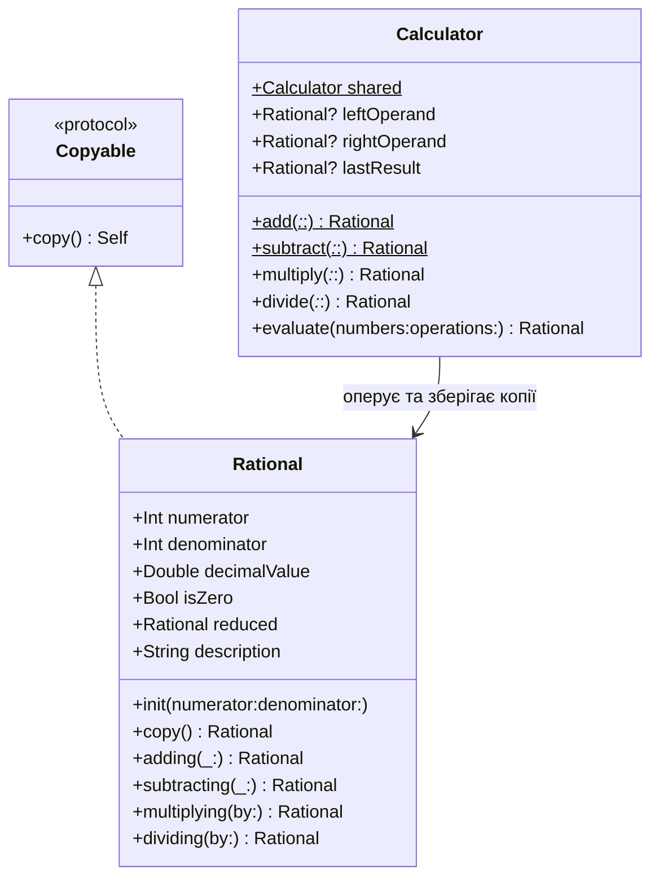

# Лабораторна робота №4: Раціональні числа та Калькулятор (Swift)


Практична реалізація об'єктно-орієнтованої моделі для роботи зі звичайними дробами (`Rational`) та калькулятора (`Calculator`), який підтримує базові арифметичні дії та обчислення складних виразів з урахуванням пріоритету операцій.

---

## Зміст

1. [Огляд архітектури](#огляд-архітектури)
2. [Опис компонентів](#опис-компонентів)
   - [Протокол `Copyable`](#протокол-copyable)
   - [Клас `Rational`](#клас-rational)
   - [Клас `Calculator`](#клас-calculator)
3. [Обчислення виразів із пріоритетом операцій](#обчислення-виразів-із-пріоритетом-операцій)
4. [Приклади використання](#приклади-використання)
5. [Результат роботи програми](#результат-роботи-програми)
6. [Структура та запуск](#структура-та-запуск)

---

## Огляд архітектури

Програма побудована на взаємодії протоколу копіювання та двох `final`-класів. Нижче наведено схему їхніх зв'язків (автоматично відображається на GitHub):



---

## Опис компонентів

### Протокол `Copyable`

Оскільки класи в Swift є **посилальними типами (Reference Types)**, звичайне присвоєння копіює лише посилання на той самий об'єкт у пам'яті. Протокол `Copyable` із методом `copy() -> Self` гарантує можливість створення незалежної глибокої копії об'єкта.

### Клас `Rational`

Представляє звичайний дріб $\frac{a}{b}$ та підписується на три протоколи: `Copyable`, `Comparable` і `CustomStringConvertible`.

**Ключові особливості реалізації:**
* **Автоматичне скорочення та нормалізація знаку:** під час ініціалізації дріб автоматично скорочується за допомогою алгоритму Евкліда (пошук найбільшого спільного дільника — НСД), а знак мінуса завжди переноситься в чисельник (наприклад, `-4 / -6` одразу перетворюється на `2/3`).
* **Безпека через спостерігачі (`didSet`):** зміна `numerator` або `denominator` автоматично запускає нормалізацію знаку. Якщо спробувати встановити знаменник рівним `0`, програма зупиняється з повідомленням про помилку (`fatalError`).
* **Обчислювані властивості (read-only):**
  * `decimalValue` — повертає десяткове представлення дробу (`Double`).
  * `isZero` — перевіряє, чи дорівнює дріб нулю.
  * `reduced` — повертає новий скорочений екземпляр `Rational`.
  * `description` — формує зручний рядок для друку (якщо знаменник дорівнює `1`, виводиться лише ціле число).
* **Порівняння (`Comparable`):** оператори `==` та `<` працюють через перехресне множення без втрати точності на числах із плаваючою комою:
  $$\frac{a}{b} < \frac{c}{d} \iff a \cdot d < c \cdot b$$

### Клас `Calculator`

Реалізований за патерном проєктування **Одинак (Singleton)** через статичну властивість `Calculator.shared` та приватний ініціалізатор `private init()`.

* **Збереження стану:** калькулятор зберігає копії останніх операндів (`leftOperand`, `rightOperand`) і результат останньої операції (`lastResult`, доступний лише для читання ззовні через `private(set)`).
* **Поєднання методів класу та екземпляра:**
  * `Calculator.add(_:_:)` та `Calculator.subtract(_:_:)` — статичні методи класу.
  * `multiply(_:_:)` та `divide(_:_:)` — методи екземпляра.
* **Перерахування `Operation`:** описує допустимі арифметичні знаки (`+`, `-`, `*`, `/`).

---

## Обчислення виразів із пріоритетом операцій

Метод `evaluate(numbers:operations:)` приймає масив дробів і масив операцій між ними, після чого виконує обчислення у **два проходи**:

1. **Перший прохід (високий пріоритет):** зліва направо знаходяться всі операції `*` та `/`. Результат записується на місце лівого операнда, а правий операнд та виконана операція видаляються з масивів.
2. **Другий прохід (низький пріоритет):** послідовно виконуються всі операції `+` та `-`, що залишилися.

> **Приклад із демонстрації:**
> $$\frac{1}{2} + \frac{3}{5} \cdot \frac{2}{3} - \frac{1}{4} \div \frac{1}{2} = \frac{1}{2} + \frac{2}{5} - \frac{1}{2} = \frac{2}{5} = 0.4$$

---

## Приклади використання

```swift
// 1. Створення та автоматичне скорочення дробів
let r1 = Rational(numerator: 2, denominator: 4)   // 1/2
let r2 = Rational(numerator: 3, denominator: 5)   // 3/5
let r3 = Rational(numerator: -4, denominator: -6) // 2/3

// 2. Безпечне копіювання без зміни оригіналу
let r1Copy = r1.copy()
r1Copy.numerator = 7 // r1 залишається 1/2, а r1Copy стає 7/2

// 3. Робота з Calculator (Singleton)
let calc = Calculator.shared
let sum = Calculator.add(r1, r2)   // 11/10 (метод класу)
let prod = calc.multiply(r1, r3)   // 1/3   (метод екземпляра)

// 4. Обчислення складного виразу з пріоритетом операцій
let numbers = [r1, r2, r3, Rational(numerator: 1, denominator: 4), r1]
let operations: [Calculator.Operation] = [.add, .multiply, .subtract, .divide]
let result = calc.evaluate(numbers: numbers, operations: operations) // 2/5
```

---

## Результат роботи програми

Після запуску функції `runDemonstration()` у консоль виводиться такий результат:

```text
=== 1. Ініціалізація та властивості Rational ===
r1 (2/4) -> 1/2, десяткове значення (readonly property): 0.5
r2 (3/5) -> 3/5, десяткове значення: 0.6
r3 (-4/-6) -> 2/3

=== 2. Копіювання об'єктів ===
Оригінал r1: 1/2 | Модифікована копія r1Copy: 7/2

=== 3. Порівняння об'єктів Rational ===
1/2 == 1/2 -> true
1/2 < 3/5 -> true
2/3 > 3/5 -> true

=== 4. Базові операції через Calculator ===
Метод класу (+): 1/2 + 3/5 = 11/10
Метод класу (-): 3/5 - 1/2 = 1/10
Метод екземпляра (*): 1/2 * 2/3 = 1/3
Метод екземпляра (/): 3/5 / 2/3 = 9/10
Властивість calc.lastResult: 9/10

=== 5. Пріоритет арифметичних операцій (без дужок) ===
Вираз: 1/2 + 3/5 * 2/3 - 1/4 / 1/2
Результат з урахуванням пріоритету: 2/5 (десяткове: 0.4)
```

---

## Структура та запуск

```text
lab4_Toroni/
├── README.md          # Документація лабораторної роботи
└── task/
    └── main.swift     # Повний вихідний код та демонстрація
```

### Як запустити
* **Через термінал (macOS / Linux зі встановленим Swift):**
  ```bash
  swift lab4_Toroni/task/main.swift
  ```
* **Через Xcode:** відкрийте `main.swift` у проєкті **Command Line Tool** або **Playground** та натисніть `Cmd + R`.
* **Онлайн:** скопіюйте вміст `main.swift` у [SwiftFiddle](https://swiftfiddle.com/) або [OnlineGDB](https://www.onlinegdb.com/online_swift_compiler) та натисніть **Run**.
